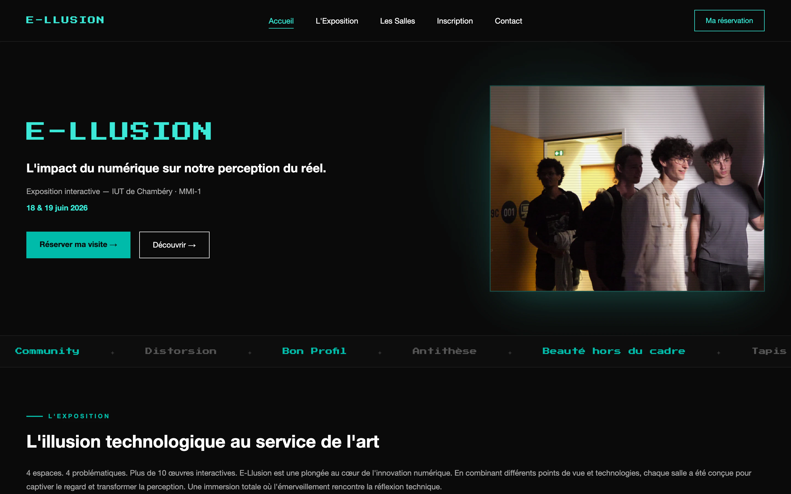
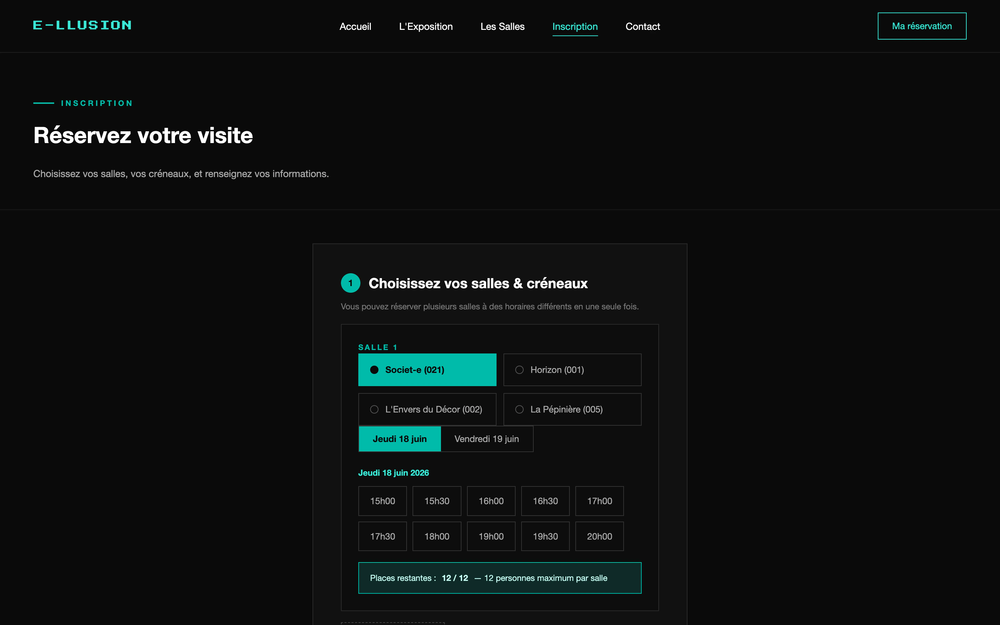
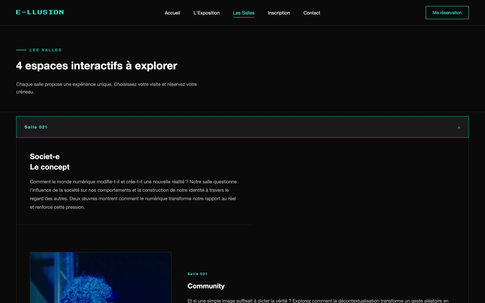

# E-LLUSION — site de réservation

Site de réservation de l'exposition interactive **E-LLUSION** (IUT de Chambéry, MMI-1, 18 & 19 juin 2026) — projet SAÉ 203.

## Fonctionnalités
- Réservation d'une visite : salle, jour, créneau, nombre de personnes, buffet.
- Code de réservation unique (ex. `ELL-6E8E58`) généré automatiquement, sans création de compte.
- « Ma réservation » : consulter, modifier ou annuler avec ce code.
- Back-office admin : liste des réservations, places occupées, édition / suppression.
- v2 : vidéo en accueil, titre glitch, bandeau des 12 œuvres, boucle vidéo par œuvre.

## Base de données (MySQL)
4 tables liées par clés étrangères : `utilisateurs`, `salles`, `creneaux` (14 créneaux), `inscriptions`.
Un trigger `gen_code_unique` génère le code de réservation à l'insertion.

| Inscription | Salles |
|---|---|
|  |  |

## Lancer en local
1. Importer `sae-203.sql` dans MySQL (base `sae-203`).
2. Adapter les identifiants dans `includes/connexion_bdd.php`.
3. `php -S localhost:8000` à la racine.

> Projet pédagogique : les identifiants admin (`admin` / `admin123`) et la connexion MySQL utilisent les valeurs par défaut de MAMP. À changer avant toute mise en ligne.

## Stack
PHP · MySQL (PDO) · HTML · CSS · JavaScript

## Équipe
- **Quentin Chillet** ([@quentin-cht](https://github.com/quentin-cht)) — base du site (dépôt d'origine : [quentin-cht/sae_203](https://github.com/quentin-cht/sae_203))
- **Luis Rivas** — front + back, base de données, version 2 (animations, vidéos)
